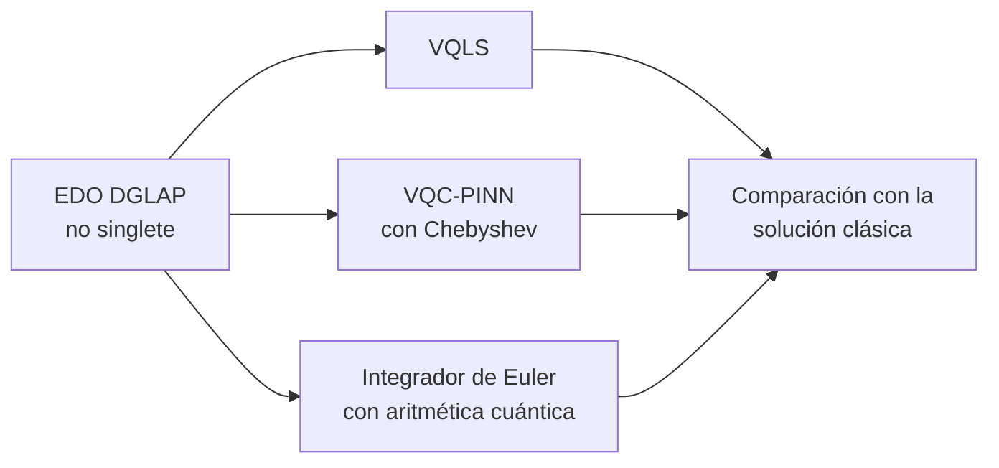

# Algoritmos cuánticos para ecuaciones de evolución DGLAP


Código desarrollado en mi Trabajo de Fin de Grado en Física: implementación en **PennyLane** de tres algoritmos cuánticos para resolver ecuaciones diferenciales ordinarias, aplicados a una versión simplificada de las **ecuaciones de evolución DGLAP** de la física de altas energías, como caso particular final.

El objetivo no es obtener ventaja cuántica (todo se ejecuta en simulador), sino estudiar cómo se comportan estos algoritmos en un problema físico real: qué precisión alcanzan, cómo convergen y dónde están sus limitaciones. Caracterizaremos los puntos relevantes de cada método, así como los impedimentos y restricciones que nos encontramos al trabajar con ellos.

## Motivación
La computación cuántica se presenta como un campo que promete mejorar la escala de ejecución de ciertos algoritmos clásicos. Algunos ejemplos son el algoritmo de Shor para la factorización en números primos, que introduce una aceleración exponencial a su mejor contraparte clásica, o el algoritmo de Grover de búsqueda en una lista, que aporta una mejora cuadrática. Su principal impedimento es la dificultad de implementación en hardware real.

La investigación en métodos cuánticos para la resolución de ecuaciones diferenciales es un campo que se empieza a consolidar alrededor de 2017-2020 junto con la llamada era NISQ de la computación cuántica, que abre paso a una aplicación a mayor escala de algoritmos como el HHL, y la exploración de los denominados algoritmos cuánticos variacionales (VQA). Se trata, pues, de un campo muy actual y relevante de investigación que está supeditado a las estrictas limitaciones tecnológicas que tiene la computación cuántica a día de hoy, pero que quizá algún día se puedan desplegar llegando a competir con algunos algoritmos clásicos.

## Algoritmos implementados



| Método | Idea | Notebook |
|---|---|---|
| **VQLS** (*Variational Quantum Linear Solver*) | Se discretiza la EDO con diferencias finitas / Euler y se resuelve el sistema lineal resultante con un circuito variacional, minimizando una función de coste local estimada con pruebas de Hadamard. | [`01_vqls.ipynb`](notebooks/01_vqls.ipynb) |
| **VQC-PINN con Chebyshev** | Un circuito cuántico variacional con mapa de características de Chebyshev actúa como red neuronal informada por la física: se entrena minimizando el residuo de la EDO. | [`02_chebyshev_vqc_pinn.ipynb`](notebooks/02_chebyshev_vqc_pinn.ipynb) |
| **Integrador de Euler cuántico** | El paso de Euler se implementa con aritmética en punto fijo sobre registros de qubits, con sumadores basados en la QFT y restas por complemento. | [`03_euler_cuantico_qft.ipynb`](notebooks/03_euler_cuantico_qft.ipynb) |

### VQLS en detalle

El notebook de VQLS aplica el método a un problema de contorno de referencia, $y'' + \omega^2 y = 0$ en $x \in [0, 2]$ con $y(0) = y(2) = 1$ y $\omega = 3$, y recorre todo el flujo del algoritmo:

1. **Discretización** por diferencias finitas centradas en 8 puntos ($2^3$, es decir, 3 qubits), que da un sistema $A\mathbf{y} = \mathbf{b}$.
2. **Ecuaciones normales y escalado**: se resuelve $A^\dagger A\,\mathbf{y} = A^\dagger \mathbf{b}$, lo que da una matriz hermítica con la misma solución.
3. **Descomposición en cadenas de Pauli** (combinación lineal de unitarios): 15 términos.
4. **Ansatz** `StronglyEntanglingLayers` (3 capas, 27 parámetros) y **función de coste local** $C_L$, evaluada con pruebas de Hadamard sobre un qubit ancilla.
5. **Optimización clásica** con Adam (Optax) y diferenciación automática con JAX, con checkpoints para reanudar el entrenamiento.
6. **Lectura de la solución** a partir de las probabilidades de medida y comparación con la solución matricial y con `scipy.integrate.solve_bvp`.

En la ejecución guardada, el coste local baja de ~$5\cdot10^{-2}$ a ~$10^{-4}$ (mínimo de ~$6.5\cdot10^{-5}$).

### Resumen de resultados

- **VQLS** fue el método con mejor comportamiento en el problema DGLAP.
- **VQC-PINN con Chebyshev** mostró convergencia.
- **Integrador de Euler cuántico**: el factor limitante es la precisión de la aritmética de punto fijo con pocos qubits.

Los resultados completos, con gráficas y discusión, están en la memoria del TFG (`docs/`).

## Limitaciones

- Todo se ejecuta en **simuladores** (`lightning.qubit`), sin ruido ni hardware real.
- VQLS devuelve un estado normalizado. Midiendo en la base computacional solo se obtienen los **módulos** de las componentes (se pierde el signo) y la escala global hay que fijarla con información adicional.
- Los tamaños son pequeños (unos pocos qubits). El coste del cálculo de la función de coste crece rápido con el número de términos de Pauli.

## Estructura del repositorio

```
.
├── README.md
├── notebooks/
│   ├── 01_vqls.ipynb
│   ├── 02_chebyshev_vqc_pinn.ipynb
│   └── 03_euler_cuantico_qft.ipynb
└── docs/
    └── memoria_tfg.pdf
```

## Instalación y uso

Probado con Python 3.13 y PennyLane 0.44.0.

```bash
git clone https://github.com/<usuario>/<repositorio>.git
cd <repositorio>

python -m venv .venv
source .venv/bin/activate        # en Windows: .venv\Scripts\activate

pip install pennylane pennylane-lightning jax optax matplotlib scipy notebook
jupyter notebook notebooks/
```

Notas para ejecutar los notebooks:

- Los notebooks están pensados para leerse y ejecutarse **en orden**, celda a celda.
- El notebook de VQLS pide por consola si se reanuda el entrenamiento desde un archivo de checkpoints (`costes`). Ese archivo se guarda con `pickle`: no cargues checkpoints de procedencia desconocida.

## Referencias

- C. Bravo-Prieto, R. LaRose, M. Cerezo, Y. Subasi, L. Cincio, P. J. Coles, *Variational Quantum Linear Solver*, [Quantum 7, 1188 (2023)](https://quantum-journal.org/papers/q-2023-11-22-1188), [arXiv:1909.05820](https://arxiv.org/abs/1909.05820).
- A. Mari, tutorial de PennyLane [*Variational quantum linear solver*](https://www.pennylane.ai/demos/tutorial_vqls), en el que se basa la estructura del circuito de VQLS (prueba de Hadamard local y función de coste).
- V. Bergholm et al., *PennyLane: Automatic differentiation of hybrid quantum-classical computations*, [arXiv:1811.04968](https://arxiv.org/abs/1811.04968).

## Autoría

TFG de **\<Nombre y apellidos\>**, Grado en Física, **\<Universidad\>**, curso 2025-2026.

Dirigido por Germán Fabricio Roberto Sborlini y David Rentería Estrada.

## Licencia

Ver el archivo [`LICENSE`](LICENSE).
